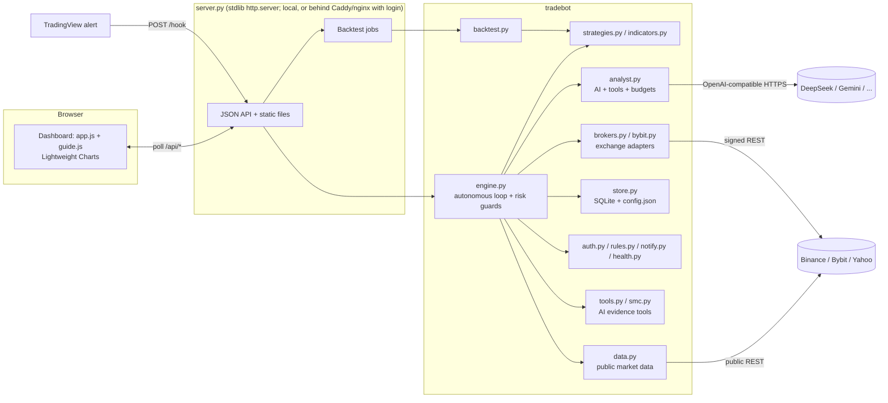

# Sentinel

**An autonomous crypto and forex trading bot with a TradingView-style dashboard, sign-in for hosting on your own domain, a research-backed trend strategy, and a token-lean AI analyst.**
Created by Reid. Pure Python standard library on the server, plain JavaScript in the browser: no dependencies to install, no build step, no paid services required.

    

> **Disclaimer.** Sentinel is educational software, not financial advice. It starts in practice (paper) mode and has never been run against a real-money account. Past performance does not predict future results. You can lose money trading.

## Quick start

```bash
# Windows: double-click run.bat        Mac/Linux: ./run.sh        or anywhere:
python server.py          # then open http://localhost:8765
```

Want it on a website with a login (for example a subdomain)? Follow **[docs/DEPLOY.md](docs/DEPLOY.md)**: Docker or systemd, Caddy or nginx, free https, first-run owner setup.

The first launch opens a **setup wizard** (practice balance, risk level, optional AI key), starts the bot, and offers a **1-minute guided tour**. A full beginner guide is in **[docs/MANUAL.md](docs/MANUAL.md)**.

## What it does

- **Trend mix, the default strategy** ([evidence](docs/STRATEGY_STUDY.md)): four independent 4-hour trend systems run on **38 liquid crypto perps** (plus 3 forex pairs, and 7 big US stocks watch-only). Each system is its own *sleeve* with its own position and trailing stop, which tested clearly better than one blended signal. Add anything with the **+ button**: 190+ curated markets, every live Binance perpetual, and Yahoo search for any other ticker. **Star** favorites to pin them to the top.
- **Evidence first**: every claim in the product traces to a walk-forward study on real candles with fees, in [`research/`](research). Short-term strategies (15m to 1h, including ICT / Smart-Money patterns) **lost money after costs in every test**, so the fast AI day trader is off by default and labelled experimental.
- **Trend scanner** (Trader page): live distance of every coin to its next breakout trigger, so a quiet stretch is explained instead of mysterious.
- **AI day trader + chat** (experimental): a scanner flags setups on 15-minute candles; the AI sees each trigger's *measured track record on that coin* and can call evidence tools (liquidity levels, multi-timeframe trend, order-book and taker flow, trigger history) before deciding. Every step streams into **Live thoughts**; a read-only **chat** answers questions about the account and its own decisions.
- **Trading rules** (checked before every entry, with a plain-English reason whenever one blocks a trade): trading hours and weekdays, long/short only, max trades per day, per-coin cool-down, pause after a run of stop-outs, cap on total day-trade risk.
- **Sign-in and accounts**: owner and view-only roles, hashed passwords, secure cookies, brute-force lockout, CSRF protection, first-run setup code. Optional on a home computer, forced on when you host it.
- **Make it yours**: light, dark or auto theme, accent colour, colour-blind-safe price colours, density, text size, corner roundness, currency symbol, 12/24-hour clock, landing page, app name, and which Home sections show.
- **Alerts**: Discord, Slack, Telegram or any webhook when a trade opens or closes or something needs attention.
- **Health panel + `doctor`**: one chip tells you what is wrong in plain English and how to fix it (data feed, AI, loop, security); `python sentinel.py doctor` tests every price feed from the machine it runs on.
- **Resilient data**: Binance futures, then Bybit, then Binance spot as automatic backups; pauses itself during a rate-limit ban instead of extending it; ignores frozen or delisted contracts.
- **Switchable timeframes**: chart timeframe 1m to 1d; the swing bot's own timeframe from Settings (4h is the only one that tested profitable).
- **15 AI providers**, one obvious place for the key (top-bar AI chip): DeepSeek, Gemini, Groq, Cerebras, OpenAI, Anthropic Claude, xAI Grok, OpenRouter, Together, Fireworks, Mistral, Ollama, LM Studio, any OpenAI-compatible URL, and the Claude CLI, with live model lists and plain-English error messages.
- **Fully autonomous loop**: polls markets in parallel, evaluates strategies on closed bars, sizes every trade by risk (fees included), places and trails a stop, journals everything, and survives restarts.
- **Hard safety systems**: per-trade risk cap, max open trades, leverage caps, daily-loss stop, drawdown halt that flattens the book, one-click kill switch.
- **Paper trading that behaves like an exchange**: identical fees, slippage and funding to the backtester, plus Bybit's real lot-size and minimum-order rules, so small accounts behave realistically.
- **Optional exchange mode**: Bybit Demo/Testnet and Binance Futures testnet adapters with signed API orders and exchange-side stops (tested against mock exchanges only).
- **Strategy Lab**: realistic backtests, walk-forward optimizer judged on unseen data, whole-portfolio simulation (trend mix runs each system as its own sleeve, as live).
- **AI analyst** (optional, advise-only by default) with real tool use and hard spending caps.
- **Beginner-first UI** that scales up: Simple mode for newcomers, Pro mode for everything.

## Dashboard

| Page | Purpose |
|---|---|
| **Home** | Account value with animated number roll, equity curve (1H/1D/1W/All), plain-English insight, key stats, live safety meters, getting-started checklist, **My markets** grid (favorites first, add/remove) |
| **Trader** | Trend scanner (distance to each coin's next trigger), experimental AI day trading, live thoughts feed, chat with the trader |
| **Markets** | TradingView Lightweight Charts candlesticks (1m to 1d switcher) with strategy levels, trade markers and stop lines; watchlist with sparklines; open trades, activity log, history |
| **AI helper** | Mode (Off/Advise/Veto), provider and key, spending guardrails, live scorecard, validation table, decision log |
| **Lab** *(Pro)* | Backtest, optimize, whole-portfolio test, with an honest verdict banner |
| **Help** | Quick start, how it works, glossary, troubleshooting, replay tour |
| **Settings** | Account size and risk, safety limits, exchange link, webhook, **Appearance, Trading rules, Alerts, Sign-in and accounts**, markets |

UX details: setup wizard with animated steps, spotlight guided tour across pages, glossary tooltips on every jargon term, `Ctrl+K` command palette, view transitions between pages, per-digit number roll, origin-aware spring dialogs, skeleton and progress indicators, `prefers-reduced-motion` support, responsive down to phone width. The browser talks only to the local server, polls only while the tab is visible, and caches pinned third-party files for a week.

## Architecture



### Repository layout

| Path | Lines | Role |
|---|---:|---|
| `server.py` | ~640 | HTTP server, JSON API, static files, background jobs, login/CSRF/host guard, presets |
| `tradebot/engine.py` | ~590 | Autonomous engine: parallel polling, strategy sleeves, per-bar logic, risk-checked order flow, kill switch, accounting |
| `tradebot/auth.py` | 200 | Accounts, PBKDF2 passwords, hashed-token sessions, lockout, setup code |
| `tradebot/rules.py` / `notify.py` / `health.py` | 260 | Entry rules and protections; Discord/Slack/Telegram alerts; plain-English health checks |
| `tradebot/tools.py` / `smc.py` | 420 | AI evidence tools (levels, multi-timeframe, flow, trigger history); ICT/SMC detectors used in the study |
| `tradebot/daytrader.py` / `chat.py` | 290 | AI day trader (scanner, dossier with track record, decision, reward/risk gate) and the read-only tool-using chat |
| `tradebot/llm.py` / `catalog.py` | 360 | 15-provider registry; market catalog, trend-mix definition and 38-coin universe, Binance perps, Yahoo search |
| `tradebot/analyst.py` | 225 | AI analyst: dossier, tool loop, prompt-cache-friendly layout, budgets, circuit breaker |
| `tradebot/backtest.py` | ~290 | Bar-by-bar simulator (fees, slippage, funding), walk-forward optimizer, shared-account portfolio simulator |
| `tradebot/strategies.py` / `indicators.py` | ~290 | Donchian, EMA-cross + ADX, RSI pullback, trend-filtered breakout, squeeze, mean-reversion, trend mix; indicators |
| `tradebot/store.py` | 205 | SQLite persistence, JSON config with deep-merge defaults, scorecard query |
| `tradebot/bybit.py` / `brokers.py` | 183 | Bybit V5 and Binance Futures adapters (HMAC-signed) |
| `tradebot/data.py` / `context.py` | 190 | Public market data with fallbacks, pacing and ban protection; AI feature extraction |
| `web/` | ~1,100 | Single-page dashboard (`app.js`, `guide.js`, `extra.js`, `custom.js`, CSS), `login.html`, `vendor/` |
| `research/` | - | The strategy studies and their results (reproducible) |
| `deploy/`, `Dockerfile`, `docker-compose.yml` | - | Caddy, nginx, systemd and Docker files for hosting |
| `sentinel.py` | 220 | Command line: control, `doctor`, `health`, `passwd`, `auth-off` |
| `tests.py` | ~1,100 | 71 tests (see below) |

## Trading logic (specification)

**Signals** are computed only on *closed* candles and acted on at that candle's close.

| Strategy | Entry | Stop | Used for |
|---|---|---|---|
| **Trend mix** (default, crypto) | Four independent systems per coin, each its own position: Donchian 20 (+EMA200 filter), Donchian 40, breakout confirmed by the daily EMA 20/50 trend + ADX, EMA 20/150 cross + ADX | 3 to 5 x ATR(14) trailing, per system | 38 crypto perps, 4h |
| **EMA cross + ADX** (default, forex) | EMA(10) crosses EMA(100) with ADX(14) >= 15 | 3 x ATR(14) trailing; reverse | 3 forex pairs |
| Single systems, RSI pullback, squeeze, mean-reversion, SMC/ICT detectors | see `tradebot/strategies.py`, `tradebot/smc.py` | | available in the Lab; not defaults because they did not hold up (see the study) |

**Sizing**: `qty = min(equity × risk% / (stop_distance + round-trip costs), equity × max_leverage_per_position / price)`, so a stop-out costs what you set, fees included,, then clipped to the remaining total-leverage room and rounded down to the exchange lot size. Orders below the exchange minimum are refused with an explanation of the balance required.

**Costs modelled** (per side): perps 0.05% fee + 0.03% slippage and 0.01%/8h funding; forex 0.008% spread. Stops win ties with targets inside a bar (conservative).

**Accounting**: `equity = cash + Σ(unrealized P&L − funding − estimated exit cost)`, so the displayed value equals what closing everything now would leave. Tested: books reconcile exactly to the cent after round trips.

**Defaults** (all editable): risk 0.3%/trade, max 15 open trades, leverage cap 3×, daily-loss stop 3%, drawdown halt 20%, cool-down 15 min per coin, pause after 3 stop-outs in an hour, poll every 20 s, paper balance chosen in the wizard. Presets in one tap: Trend mix (recommended), Cautious, Bold.

## Measured results

Full write-up, tables and reproduction commands: **[docs/STRATEGY_STUDY.md](docs/STRATEGY_STUDY.md)**. Headlines, all on real Binance perpetual candles with fees, slippage and funding, judged on data the settings never saw:

- **Fast loses.** 15-minute and 1-hour versions of every family tested, including liquidity sweeps, fair value gaps and order blocks, lost money out-of-sample (for example 0 of 768 FVG settings and 1 of 708 sweep settings were even profitable in-sample).
- **Slow trend-following wins, modestly.** On 4-hour candles, 33 of 33 Donchian settings and 39 of 39 trend-filtered-breakout settings that were profitable in-sample stayed profitable out-of-sample.
- **Breadth and independence help.** Four systems run as separate sleeves across 40 coins on one shared account: **+13% and +19% in two separate year-long windows, Sharpe about 0.9, max drawdown 8 to 15%, 12 to 14 trades a week**. Blending them into one signal per coin was worse.

The engine, fed historical bars one at a time, reproduces the backtester (33 vs 36 trades on a test replay, verified in the suite). These are historical results with one market regime per window; **expect worse live, and expect 10 to 20 percent drawdowns.**

## Why not faster? (the answer to "trade more")

Taker fees and slippage cost about 0.16% per round trip, which dominates on short candles. The more trades, the more the costs. So Sentinel gets *more trades through more coins* (38 instead of 10), not through faster candles, and shows what each coin is waiting for on the Trend scanner. The **AI day trader** remains available for experimentation; it measures every trigger's track record on the coin and says "flat" when the evidence is negative, which on the data so far is most of the time.

## AI analyst

Design goals: *accurate inputs, minimal tokens, bounded spend, never in the critical path.*

- **One request per actionable signal**: only after the strategy and every risk check pass; memoized per (market, candle, side).
- **DeepSeek-aware**: `deepseek-flash`, thinking disabled (it is on by default and bills hidden tokens), `max_tokens` 140, JSON reply.
- **Prompt-cache layout**: static system prompt and tool definitions first (byte-identical across calls, so automatic context caching bills them at ~1/50th price), compact signal dossier last. Live check: 384 of 797 input tokens were cache hits on the second call.
- **Real data in one round trip**: trend, volatility, momentum, BTC regime, funding rate and history, open-interest change, long/short ratio, portfolio exposure and recent results.
- **Tool use**: seven read-only tools (`candles`, `derivs`, `journal`, `levels`, `mtf`, `flow`, `edge`), max 2 rounds, then a forced final answer. `edge` measures how a trigger has paid on that coin over ~30 days, net of fees, so the model argues from data.
- **Hard budgets**: 120 calls/day, $0.25/day, $3 lifetime (defaults), computed from the provider's reported cache-hit/miss/output token counts and peak/off-peak pricing. A circuit breaker pauses AI for 10 minutes after 3 failures. Every failure fails open.
- **Honest evaluation**: replaying ~6,800 historical signals through the model showed that vetoing trades on its rating, or sizing by it, did **not** beat taking every signal (see `docs/ai_validation.json`). The default mode therefore only *advises*, tags each trade with its rating, and exposes a live scorecard to judge usefulness over time.
- Works with any OpenAI-compatible API (DeepSeek, Gemini, Groq, OpenRouter, OpenAI, local Ollama) or the Claude CLI.

## HTTP API (local, or signed-in when hosted; `/hook` and `/healthz` are open)

| Method | Path | Purpose |
|---|---|---|
| GET | `/healthz` | Liveness probe (public, no data) |
| GET | `/api/state` | Engine snapshot, public config (secrets masked), events, who you are |
| GET | `/api/health` | Plain-English health checks with fixes |
| GET | `/api/equity`, `/api/trades`, `/api/trades.csv` | Equity curve, journal, CSV export |
| GET | `/api/candles?inst=` | Closed + forming candles, strategy overlays, trade markers |
| GET | `/api/spark`, `/api/thoughts`, `/api/catalog`, `/api/ai/log`, `/api/job?id=` | Sparklines, live reasoning, market search, AI log, backtest status |
| POST | `/api/engine` | `start`, `stop`, `kill`, `resume`, `flatten`, `close` |
| POST | `/api/config` | Partial config update (live mode needs typed confirmation) |
| POST | `/api/preset`, `/api/watchlist`, `/api/speed`, `/api/account`, `/api/reset` | One-tap strategy presets, markets, timeframe, paper account |
| POST | `/api/backtest`, `/api/chat`, `/api/ai/*`, `/api/broker/test`, `/api/notify/test` | Lab jobs, chat, AI and connection tests, alert test |
| GET/POST | `/api/auth/*` | `status`, `login`, `logout`, `setup`, `password`, `users`, `sessions`, `disable` |
| POST | `/hook` | TradingView webhook (secret-authenticated) |

## Security model

- **Local use (default):** binds to `127.0.0.1`; every route except `/hook` rejects non-local, proxied or forwarded requests, and only `localhost` Host names are served.
- **Hosted (`SENTINEL_HOSTS` or `SENTINEL_AUTH=1`):** sign-in is required for everything except `/healthz`, the sign-in page and `/hook`. PBKDF2-SHA256 (600k rounds) passwords; random session tokens in `HttpOnly` + `SameSite=Lax` (+`Secure` on https) cookies, stored hashed; 5 failures lock the address and the account for 15 minutes; a password change signs out every device; writes need the cookie, an `X-Sentinel` header and a matching `Origin`; unknown `Host` names get 421; security headers on every response; first owner requires a one-time setup code. View-only accounts cannot write, trade, or spend AI money.
- API keys live only in `data/config.json` (git-ignored) and are never returned by the API (only `has_*` flags); webhook URLs and bot tokens are treated the same.
- Live/exchange mode requires typing `I UNDERSTAND`. Exchange keys should have no withdrawal permission.
- Static server is path-traversal safe; pinned vendor files are cached, app files are version-stamped and never stale.

## Testing

`python tests.py` runs **71 tests in about 45 s**, none of which can touch a real AI API or exchange (mock servers are used):

indicators and backtester sanity (costs hurt, stops bound losses) · live-engine replay equals backtester · shared-account portfolio simulator respects max open trades · trend-mix sleeves open/close independently · accounting reconciliation to the cent · risk limits, kill switch, daily-loss and drawdown guards · entry rules (hours, direction, caps, cool-down, stop-out pause) · tiny-account lot-size rules · dead-contract guard · data fallback and ban protection · alerts (payloads, delivery, event routing) · AI evidence tools (causal triggers, costs charged) · webhook auth · Bybit adapter against a signature-verifying mock exchange · AI analyst: prompt-prefix stability, cost math, tool round-trip, budgets, circuit breaker, fail-open, scorecard · accounts, lockout, idle expiry · the full HTTP login flow (first-run code, cookies, CSRF, roles, host checks) · API security (secrets never leave, forwarded requests rejected, traversal blocked) · cache headers · first-run flags.

## Project structure for contributors

Plain stdlib Python 3.7+ and vanilla JS: read `tradebot/engine.py` first, then `tradebot/analyst.py`. `data/` (database, config, price cache) is created at runtime and git-ignored.

## Known limitations

- Exchange adapters are verified against mock exchanges and Bybit's public rules, never against a live account. Forex runs in the built-in simulator only (Yahoo prices are approximate).
- The strategies are classic trend-following; the measured edge is modest and regime-dependent (see the study's honest-limits section). Fast trading is not profitable after fees in our tests.
- A single-owner app: several people can sign in, but there is one shared account and one set of keys. It is not a multi-tenant service.
- Binance and Bybit block some regions; run `python sentinel.py doctor` on the machine that will host it.

## Development

Designed and directed by Reid. Built with AI pair-programming assistance (Claude Code).

## License

MIT, see [LICENSE](LICENSE). Third-party components: [THIRD_PARTY_NOTICES.md](THIRD_PARTY_NOTICES.md).
