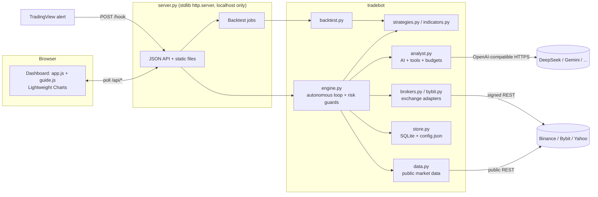

# Sentinel

**An autonomous crypto and forex trading bot with a TradingView-style dashboard, a guided first-run experience, and a token-lean AI analyst.**
Created by Reid. Pure Python standard library on the server, plain JavaScript in the browser: no dependencies to install, no build step, no paid services required.

    

> **Disclaimer.** Sentinel is educational software, not financial advice. It starts in practice (paper) mode and has never been run against a real-money account. Past performance does not predict future results. You can lose money trading.

## Quick start

```bash
# Windows: double-click run.bat        Mac/Linux: ./run.sh        or anywhere:
python server.py          # then open http://localhost:8765
```

The first launch opens a **setup wizard** (practice balance, risk level, optional AI key), starts the bot, and offers a **1-minute guided tour**. A full beginner guide is in **[docs/MANUAL.md](docs/MANUAL.md)**.

## What it does

- **Trades 13 markets 24/7** on 4-hour candles: 10 crypto perpetual futures (BTC, ETH, SOL, BNB, XRP, DOGE, ADA, LINK, LTC, AVAX) and 3 forex pairs (EUR/USD, GBP/USD, USD/JPY).
- **Fully autonomous loop**: polls markets in parallel, evaluates strategies on closed bars, sizes every trade by risk, places and trails a stop, journals everything, and survives restarts.
- **Hard safety systems**: per-trade risk cap, max open trades, leverage caps, daily-loss stop, drawdown halt that flattens the book, one-click kill switch.
- **Paper trading that behaves like an exchange**: identical fees, slippage and funding to the backtester, plus Bybit's real lot-size and minimum-order rules, so small accounts behave realistically.
- **Optional exchange mode**: Bybit Demo/Testnet and Binance Futures testnet adapters with signed API orders and exchange-side stops (tested against mock exchanges only).
- **Strategy Lab**: realistic backtests, walk-forward optimizer judged on unseen data, whole-portfolio simulation.
- **AI analyst** (optional, advise-only by default) with real tool use and hard spending caps.
- **Beginner-first UI** that scales up: Simple mode for newcomers, Pro mode for everything.

## Dashboard

| Page | Purpose |
|---|---|
| **Home** | Account value with animated number roll, equity curve (1H/1D/1W/All), plain-English insight, key stats, live safety meters, getting-started checklist |
| **Markets** | TradingView Lightweight Charts candlesticks with strategy levels, trade markers and stop lines; watchlist with sparklines; open trades, activity log, history |
| **AI helper** | Mode (Off/Advise/Veto), provider and key, spending guardrails, live scorecard, validation table, decision log |
| **Lab** *(Pro)* | Backtest, optimize, whole-portfolio test, with an honest verdict banner |
| **Help** | Quick start, how it works, glossary, troubleshooting, replay tour |
| **Settings** | Account size and risk, safety limits, exchange link, webhook, markets |

UX details: setup wizard with animated steps, spotlight guided tour across pages, glossary tooltips on every jargon term, `Ctrl+K` command palette, view transitions between pages, per-digit number roll, origin-aware spring dialogs, skeleton and progress indicators, `prefers-reduced-motion` support, responsive down to phone width. The browser talks only to the local server, polls only while the tab is visible, and caches pinned third-party files for a week.

## Architecture



### Repository layout

| Path | Lines | Role |
|---|---:|---|
| `server.py` | 324 | HTTP server, JSON API, static files, background jobs, local-only guard |
| `tradebot/engine.py` | 425 | Autonomous engine: parallel polling, per-bar logic, risk-checked order flow, kill switch, accounting |
| `tradebot/analyst.py` | 220 | AI analyst: dossier, tool loop, prompt-cache-friendly layout, budgets, circuit breaker |
| `tradebot/backtest.py` | 144 | Bar-by-bar simulator with fees, slippage, funding, walk-forward optimizer, portfolio combiner |
| `tradebot/strategies.py` / `indicators.py` | 139 | Donchian breakout, EMA-cross + ADX, RSI pullback; EMA/SMA/RSI/ATR/ADX/Donchian |
| `tradebot/store.py` | 176 | SQLite persistence, JSON config with deep-merge defaults, scorecard query |
| `tradebot/bybit.py` / `brokers.py` | 183 | Bybit V5 and Binance Futures adapters (HMAC-signed) |
| `tradebot/data.py` / `context.py` | 144 | Public market data with CSV cache; AI feature extraction |
| `web/` | ~850 | Single-page dashboard (`app.js`, `guide.js`, `style.css`, `index.html`) + `vendor/` |
| `sentinel.py` | 138 | Command-line controller for a running instance |
| `tests.py` | 608 | 36 tests (see below) |

## Trading logic (specification)

**Signals** are computed only on *closed* 4h candles and acted on at that candle's close.

| Strategy | Entry | Stop | Used for |
|---|---|---|---|
| **Donchian breakout** (default, crypto) | Close above the prior 40-bar high → long; below the prior 40-bar low → short | 4×ATR(14) trailing; reverse on opposite signal | 10 crypto perps |
| **EMA cross + ADX** (default, forex) | EMA(10) crosses EMA(100) with ADX(14) ≥ 15 | 3×ATR(14) trailing; reverse | 3 forex pairs |
| **RSI pullback** (available) | RSI(2) extreme against an EMA trend filter | ATR stop + ATR target | optional |

**Sizing**: `qty = min(equity × risk% / stop_distance, equity × max_leverage_per_position / price)`, then clipped to the remaining total-leverage room and rounded down to the exchange lot size. Orders below the exchange minimum are refused with an explanation of the balance required.

**Costs modelled** (per side): perps 0.05% fee + 0.03% slippage and 0.01%/8h funding; forex 0.008% spread. Stops win ties with targets inside a bar (conservative).

**Accounting**: `equity = cash + Σ(unrealized P&L − funding − estimated exit cost)`, so the displayed value equals what closing everything now would leave. Tested: books reconcile exactly to the cent after round trips.

**Defaults** (all editable): risk 0.5%/trade, max 6 open trades, leverage cap 3×, daily-loss stop 3%, drawdown halt 20%, poll every 20 s, paper balance $1,000 (chosen in the wizard).

## Measured results

13 markets, 5 years of real data, 4h bars, after fees, slippage and funding, equal risk per position:

| Risk per trade | Total return | CAGR | Max drawdown | Sharpe |
|---:|---:|---:|---:|---:|
| 0.5% | +55% | 7.6% | 19.6% | 0.56 |
| 1.0% | +109% | 13.1% | 29% | 0.61 |

Both halves of the period were profitable (Sharpe 0.6 / 0.5). The settings were chosen after seeing this data, and individual markets often show no edge on unseen data. **Expect worse in live trading.** The live engine, fed historical bars one at a time, reproduces the backtester's results (33 vs 36 trades, similar P&L), which is verified in the test suite.

## AI analyst

Design goals: *accurate inputs, minimal tokens, bounded spend, never in the critical path.*

- **One request per actionable signal**: only after the strategy and every risk check pass; memoized per (market, candle, side).
- **DeepSeek-aware**: `deepseek-flash`, thinking disabled (it is on by default and bills hidden tokens), `max_tokens` 140, JSON reply.
- **Prompt-cache layout**: static system prompt and tool definitions first (byte-identical across calls, so automatic context caching bills them at ~1/50th price), compact signal dossier last. Live check: 384 of 797 input tokens were cache hits on the second call.
- **Real data in one round trip**: trend, volatility, momentum, BTC regime, funding rate and history, open-interest change, long/short ratio, portfolio exposure and recent results.
- **Tool use**: three read-only tools (`candles`, `derivs`, `journal`), max 2 rounds, then a forced final answer.
- **Hard budgets**: 120 calls/day, $0.25/day, $3 lifetime (defaults), computed from the provider's reported cache-hit/miss/output token counts and peak/off-peak pricing. A circuit breaker pauses AI for 10 minutes after 3 failures. Every failure fails open.
- **Honest evaluation**: replaying ~6,800 historical signals through the model showed that vetoing trades on its rating, or sizing by it, did **not** beat taking every signal (see `docs/ai_validation.json`). The default mode therefore only *advises*, tags each trade with its rating, and exposes a live scorecard to judge usefulness over time.
- Works with any OpenAI-compatible API (DeepSeek, Gemini, Groq, OpenRouter, OpenAI, local Ollama) or the Claude CLI.

## HTTP API (local only, except `/hook`)

| Method | Path | Purpose |
|---|---|---|
| GET | `/api/state` | Engine snapshot, public config (secrets masked), events |
| GET | `/api/equity`, `/api/trades`, `/api/trades.csv` | Equity curve, journal, CSV export |
| GET | `/api/candles?inst=` | Closed + forming candles, strategy overlays, trade markers |
| GET | `/api/spark` | Sparkline data (kept out of the hot state payload) |
| GET | `/api/ai/log` | AI decisions, spend, budgets, scorecard, validation |
| GET | `/api/job?id=` | Background backtest/optimize status |
| POST | `/api/engine` | `start`, `stop`, `kill`, `resume`, `flatten`, `close` |
| POST | `/api/config` | Partial config update (live mode needs typed confirmation) |
| POST | `/api/account` | Fresh paper account with a chosen balance |
| POST | `/api/backtest` | `single`, `optimize`, `portfolio` jobs |
| POST | `/api/ai/test`, `/api/ai/brief`, `/api/broker/test` | Connection tests and brief |
| POST | `/hook` | TradingView webhook (secret-authenticated; the only externally reachable route) |

## Security model

- Binds to `127.0.0.1`. Every route except `/hook` rejects non-local, proxied or forwarded requests, so tunnelling the port for TradingView does not expose the dashboard.
- API keys live only in `data/config.json` (git-ignored) and are never returned by the API (only `has_*` flags).
- Live/exchange mode requires typing `I UNDERSTAND`. Exchange keys should have no withdrawal permission.
- Static server is path-traversal safe; pinned vendor files are cached, app files are version-stamped and never stale.

## Testing

`python tests.py` runs **36 tests in ~30 s**, none of which can touch a real AI API or exchange (mock servers are used):

indicators and backtester sanity (costs hurt, stops bound losses) · live-engine replay equals backtester · accounting reconciliation to the cent · risk limits, kill switch, daily-loss and drawdown guards · tiny-account lot-size rules · webhook auth and validation · Bybit adapter against a signature-verifying mock exchange (open, trail, flatten) · AI analyst: prompt-prefix stability, cost math, tool round-trip, round caps, budget hard-stops, circuit breaker, fail-open, scorecard · API security (secrets never leave, forwarded requests rejected, traversal blocked) · HTTP cache-header correctness across keep-alive connections · first-run flags.

## Project structure for contributors

Plain stdlib Python 3.7+ and vanilla JS: read `tradebot/engine.py` first, then `tradebot/analyst.py`. `data/` (database, config, price cache) is created at runtime and git-ignored.

## Known limitations

- Exchange adapters are verified against mock exchanges and Bybit's public rules, never against a live account. Forex runs in the built-in simulator only (Yahoo prices are approximate).
- The strategies are classic trend-following; the measured edge is modest and regime-dependent.
- Single-user, local-only by design; no authentication layer because nothing is exposed.

## Development

Designed and directed by Reid. Built with AI pair-programming assistance (Claude Code).

## License

MIT, see [LICENSE](LICENSE). Third-party components: [THIRD_PARTY_NOTICES.md](THIRD_PARTY_NOTICES.md).
